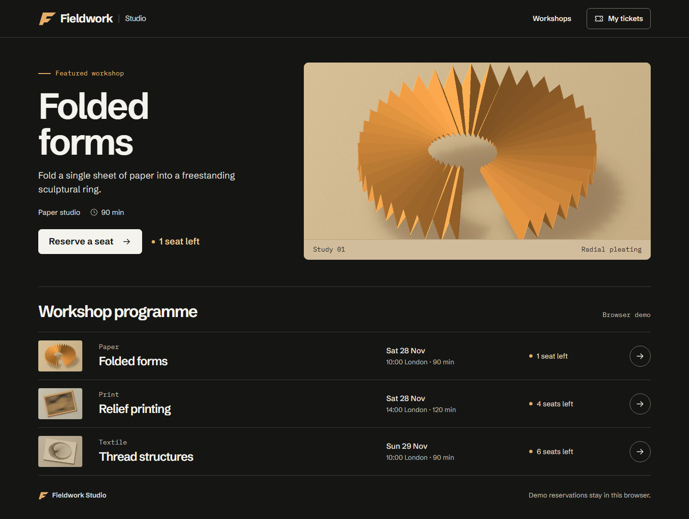

# Fieldwork Workshop Booking

A ready-to-book programme for a paper, print or textile studio. Guests choose a workshop, reserve the last seat and manage their ticket from the same browser. Connect Supabase to share availability across devices.

[Try the live demo](https://fieldwork-studio-gallery-w15.vercel.app) · [See the mobile ticket](docs/images/ticket-390.png)

[](https://vercel.com/new/clone?repository-url=https%3A%2F%2Fgithub.com%2Fohad6k%2Ffieldwork-booking-starter&project-name=fieldwork-booking-starter&repository-name=fieldwork-booking-starter)



[Reservation screen](docs/images/reserve-1440.png) · [Mobile programme](docs/images/mobile-workshops.png)

## Book your first seat

In the live demo, choose **Reserve a seat → Confirm reservation** under *Folded forms*. Reload, open **My tickets**, and select the workshop. **Cancel reservation → Release seat** returns the seat. The demo stores tickets in the browser.

To run your own copy, use Node.js 24 in the repository root.

```sh
npm ci
npm run dev
```

Open [localhost:3000](http://localhost:3000). No environment values are required for the browser demo.

## Make the programme yours

Fieldwork lists one upcoming date per workshop and features the first class in the [catalogue](lib/programme.mjs). Add each class there with its materials, demo capacity and `offsetHours`, counted from Saturday at 00:00 UTC. Add its `public/studies/<slug>.webp` image, 96px and 192px WebP copies under `public/studies/thumbs/<slug>-96.webp` and `<slug>-192.webp`, and a matching row in the [seed](supabase/seed.sql) with capacity, sample reservations and `offset_hours`. A null database offset makes a workshop a one-off.

## Share availability with Supabase

1. In a Supabase project's SQL Editor, run the [migration](supabase/migrations/20261122222124_workshop_capacity.sql), then the [seed](supabase/seed.sql).
2. Set `SUPABASE_URL` to the Project URL and `SUPABASE_SECRET_KEY` to the server secret in your hosting project's environment or a local `.env.local`. If you connected through the gallery's Supabase integration, check for `NEXT_PUBLIC_SUPABASE_URL` and `SUPABASE_SERVICE_ROLE_KEY` before adding values. Fieldwork accepts either URL variable with either server key. [Supabase key guide](https://supabase.com/docs/guides/api/api-keys)
3. Restart `npm run dev` locally or redeploy the hosted project. **Studio bookings** identifies shared availability. Guests manage their tickets in the browser where they booked. The booking endpoint accepts guests without sign-in or built-in rate limits. For a public studio, you can rate-limit requests to `/api/booking` in Vercel Firewall. To enforce a per-person allowance, require sign-in. [Vercel rate limiting](https://vercel.com/docs/vercel-firewall/vercel-waf/rate-limiting) · [Supabase Auth](https://supabase.com/docs/guides/auth)

After a recurring class closes, run [reschedule.sql](supabase/reschedule.sql) to schedule its next date from its stored offset. Past tickets keep their dates. You can automate this step with [Supabase Cron](https://supabase.com/docs/guides/cron).

For display, set `STUDIO_LOCALE` and `STUDIO_TIME_ZONE` in [programme.mjs](lib/programme.mjs). The defaults are `en-GB` and `Europe/London`. The schedule stays anchored in UTC, so London displays a class one hour later during British Summer Time.

## Check the last seat

Run `bash scripts/test-db.sh` with Docker and Bash to check last-seat bookings, cancellations and rescheduling. These sequential pgTAP tests exercise the guard. The recorded concurrency run used an unpublished VibeRaven build. The published 1.13.0 run returned **incomplete**. [Test setup, recording and results](docs/booking-proof.md)

Run `npm test` for the schedule and London time-label tests and `npm run build` for the production build. `npm run check` reviews the repository. Migration pull requests also run an advisory concurrency check. [CI workflow](.github/workflows/migrations.yml)

## License

[MIT](LICENSE). Font licenses accompany [Schibsted Grotesk](public/fonts/OFL-Schibsted.txt) and [IBM Plex Mono](public/fonts/OFL-IBM-Plex-Mono.txt).
